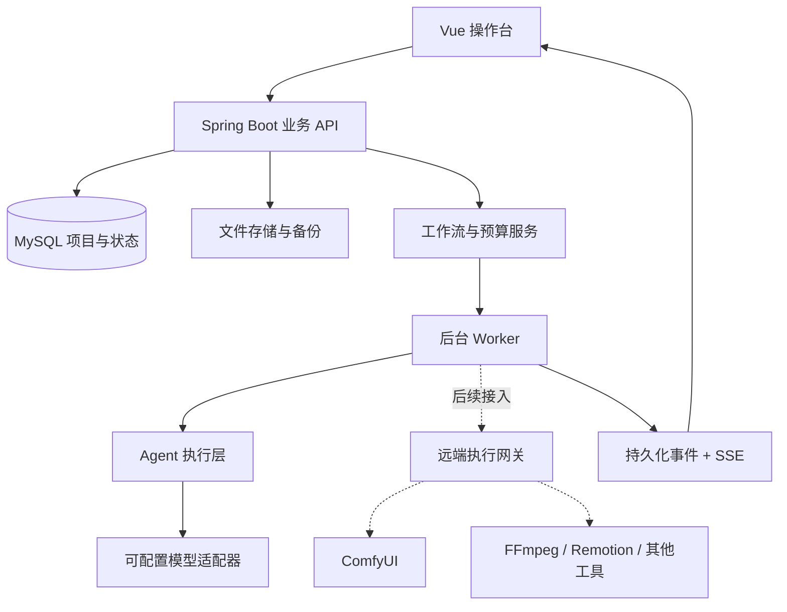

# 05 系统架构与工程拆分

## 1. 推荐架构

首版为模块化单体业务后端 + 独立前端 + 可选远端执行端。避免将 19 个 Agent 都拆为微服务。业务 API、任务调度和工具执行具有明确边界，但可在同一部署中运行。



## 2. 技术建议与版本策略

- 前端：Vue 3 + TypeScript + Vite + Router + Pinia，PC 操作台；组件库按实际原型选择。
- 业务后端：Java 21、Spring Boot、MyBatis、MySQL 8.4，迁移脚本使用版本化工具。
- 兼容组合参考：Spring Boot 4.0.x + MyBatis Starter 4.0.x；若选择 3.x 生态，则 Spring Boot 3.2—3.5 对应 Starter 3.0.x。实施时核实维护状态与补丁版本，锁定 BOM，不直接使用 master/SNAPSHOT。
- 首版任务：数据库任务表 + Worker + 租约；需要跨机吞吐时再引入消息队列。用任务 ID 作为轻量消息，文件不入队列。
- Python：只在需要原生模型/媒体库的执行端引入。当前文档检查只使用 Python 标准库。
- 不强制同时安装 LangGraph、n8n、Redis 和独立向量数据库；需要时通过接口加入。

## 3. 后端模块

| 模块 | 职责 |
| --- | --- |
| account-profile | 账号定位、资源、栏目与规范版本 |
| ideas-projects | 灵感、立项、项目和迭代 |
| workflow | 节点定义、实例化、依赖、阶段确认、影响分析 |
| agents | 角色配置、上下文构建、工具白名单与结构化产物 |
| model-registry | 服务商、协议、模型、能力、预设、绑定与测试 |
| assets | 镜头、音轨、素材、来源、文件校验和采用关系 |
| jobs | 任务、尝试、租约、幂等、重试与状态对账 |
| tools | 外部执行器登记、声明与实测能力、手工结果导入 |
| review-delivery | 审片、问题单、发布包、授权与发布记录 |
| analytics-business | 评论、指标口径、复盘、费用、收入和周期经营 |
| system | 凭据引用、审计、备份、导出与配置迁移 |

## 4. 拟议工程目录（本次不创建应用）

```text
frontend/src/{pages,components,stores,api,types}
backend/src/main/java/.../{common,profiles,projects,workflow,models,agents,assets,jobs,tools,delivery,analytics}
backend/src/main/resources/mapper/
backend/src/main/resources/db/migration/
workers/                     # 目标环境需要时再实现
contracts/                   # 后续从本次 specs 演进
```

每个业务模块包含 controller/service/mapper/entity/dto/vo。Controller 参数校验与授权；Service 事务与业务约束；Mapper 参数绑定；XML namespace 对应接口全限定名。工具适配器不直接改业务表，统一向任务服务提交状态和产物。

## 5. 最小派发事务

1. 锁定就绪节点或乐观 CAS；读取明确输入版本。
2. 校验阶段确认和授权，解析模型绑定并创建不可变快照。
3. 事务预留预算，创建 task 与 outbox_event，一起提交。
4. Worker 领取 task，写租约和 heartbeat，提交外部请求后保存 external_job_id。
5. 结果写 artifact_revision、usage、task 状态和 outbox；通过校验后更新节点。
6. 发出调度事件，计算后继可执行条件。消息至少一次投递，由幂等保证不重复作用。

网络调用不放在长数据库事务内。业务任务至多一次创建不等于外部服务至多一次计费，必须额外对账。

## 6. 运行与推送

以 task_event 表生成单调 event_id；SSE 允许 Last-Event-ID 重放。断线后 REST 获取任务当前状态与事件补差。渲染/生成任务不占用前端 HTTP 请求等待完成。

Worker 中断后通过租约发现孤儿任务；有远端任务 ID 就先查询，没收到响应也不能立即认定未受理。USER_PAUSED 与系统崩溃恢复是不同事件。

## 7. 文件、时间与镜头

- 文件用 storage_key/URI，不能在跨机业务对象中写死 D:\\ 或目标电脑的绝对路径。
- 目录按 project/iteration/shot/artifact/revision 组织，原始文件只读；采用关系单独存。
- 业务时间存 UTC 并展示 Asia/Shanghai，定时发布保存 IANA 时区和实际 UTC 时刻。
- 时间线内部用整数毫秒或有理数帧时间，保存 fps 分子/分母；不能反复用浮点秒累加。
- 媒体代理和缓存可重建，原始素材、采用关系、审批和账目是需要备份的主数据。

## 8. 模型与工具并行

服务商限流、用户预算、GPU 执行端槽位是三种独立限制。ComfyUI 自带队列不能代替整个业务队列；它不知道哪些节点已获项目批准。工具未接入时仍可创建手工交付任务。

## 9. 可扩展但不抢先实施

后续可增加工具插件、向量检索、多人协作、远端渲染与模型评测。保持 Adapter、Storage、ExecutionGateway、Publisher、MetricsImporter 接口；首版不因此引入大型平台基础设施。
