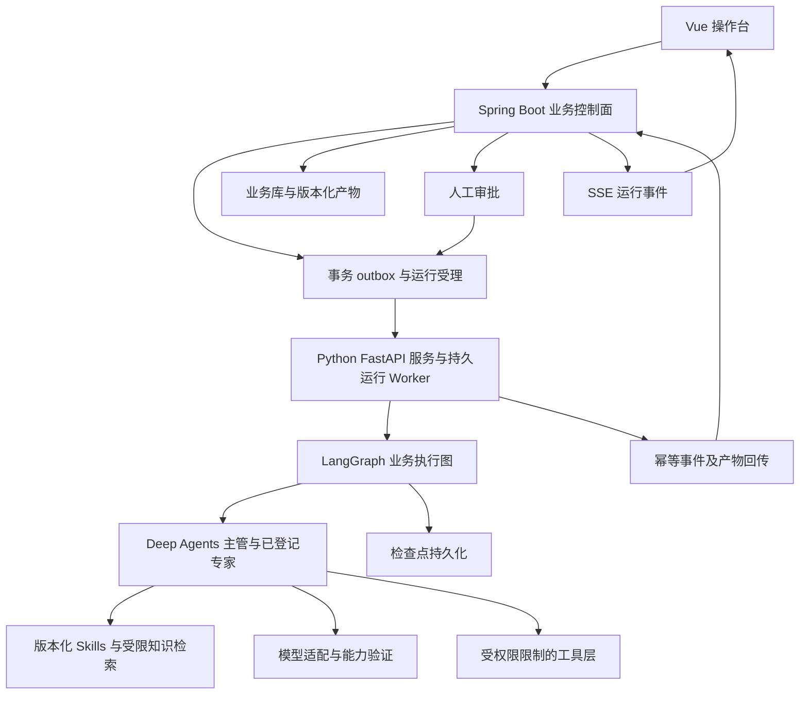
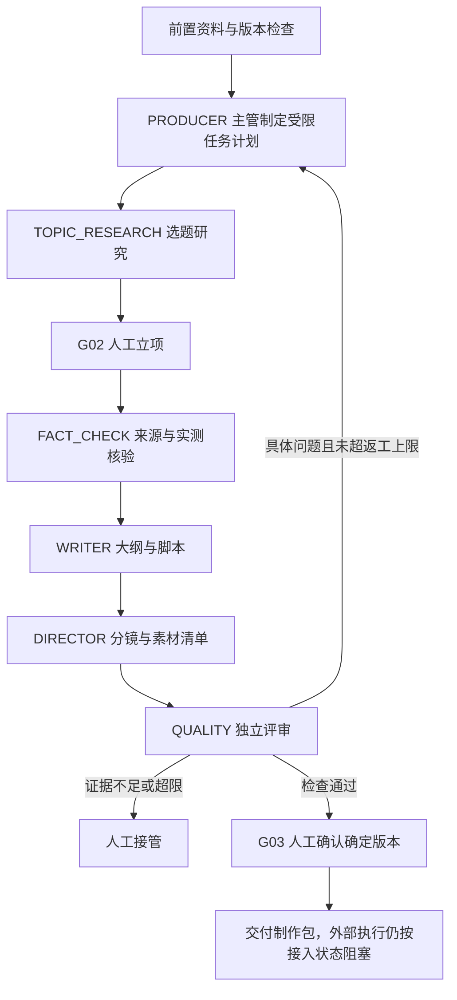

# 18 真正多 Agent 协同迁移实施方案

版本：设计稿 1.0；日期：2026-10-26；对象：`D:\Code\creator-workbench`。

**状态：0.2 已实施本机协作闭环。真实主管委派、独立专家包、评审返工、检查点、运行记录与人工采纳已实现并使用测试模型验收。本文仍包含后续生产目标；不代表全部 M0—M5 已完成。当前事实与未交付项以 [0.2 运行说明](20-multi-agent-runtime.md) 为准。本轮不调用付费模型。**

目标是交付真正运行的主管与专家团队：专家有独立任务上下文、专业 Skills、知识、工具、可验证的交付和独立评测；主管实际委派、汇总、安排评审与有限返工；操作台可查看真实执行证据。

配套文档：[19 个专家能力蓝图](19-agent-specialist-blueprints.md)、[49 节点迁移矩阵](20-node-agent-migration-matrix.md)。历史实际状态见 [14](14-running-and-implementation.md) 和 [16](16-agent-implementation.md)。本方案替代此前对下一阶段编排技术的建议，不表示历史实现已经迁移。

## 1. 本次核对的事实与交付边界

| 对象 | 当前事实 | 迁移决定 |
| --- | --- | --- |
| 前端 | Vue 3、TypeScript、Pinia、Router；全局/角色/作品/节点默认模型和能力覆盖 | 保留，增加运行、专家版本、工具、评审、成本与事件界面 |
| 业务后端 | Java 21、Spring Boot 4.0.9、MyBatis 4.0.0 | 保留为业务控制面，不引入第二套 Java Agent 编排 |
| 业务目录 | N02—N50 共 49 个活动节点；19 角色；25 能力；六个人工拍板 | 保留规范来源及稳定 ID；业务节点与专家运行分别建模 |
| 当前 Agent | 角色 JSON、模型绑定与确定性规则检查；没有 Prompt 执行和模型调用 | 新建 Python Agent 服务，不把旧记录伪装为 Agent 运行 |
| 自动推进 | `PLAN_PROJECT` 保存检查/阻塞记录 | 保留兼容检查；新建真实 run API，通过功能开关切换入口 |
| 存储 | `workspace_document` 聚合 JSON＋`media_file`；默认 H2，MySQL 配置未联调 | 新增结构化运行与产物表；异步任务不反复更新整块 JSON |
| 工具 | ComfyUI、FFmpeg、录屏、剪辑、平台等为 DOCUMENTED | 本方案只设计这些接口；执行器继续后置，未接入必须阻塞或人工交付 |
| 本机 Python | 默认命令为 3.7.0；本次文档工具可用 3.12.14 | 实施时建立项目专用 Python 3.12 环境，不修改全局解释器 |

第一版真实执行范围：有前置材料的作品，在 G01/G02/G03 约束下，运行主管、选题研究、核验、编剧、导演、质量检查六个专家，交付选题、证据、脚本、分镜和评审记录。首版不承诺自动成片或发布。

19 个角色全部有建设与验收要求；按批次启用。登记配置、模型可达、工具可用、专业验收通过是不同状态。其余角色不能被未验收的通用子 Agent 冒充。

## 2. 架构决策

### 2.1 运行结构



LangGraph 是状态和执行图底座；Deep Agents 是运行于其上的 Agent harness。首版只有这一套 Agent 编排，不同时引入 Temporal、CrewAI 或独立 Celery 调度。HTTP 受理不等于执行，不能依赖请求线程、前端页面或 FastAPI 临时后台协程维持长任务。

采用“受业务规则约束的主管—专家＋并行分支＋独立评审”模式：主管可以选择允许的专家、细分研究问题、决定有限返工，但不能修改 49 节点定义、绕过依赖或人工审批。

### 2.2 职责与数据权威

| 层 | 必须负责 | 不能负责 |
| --- | --- | --- |
| Vue | 配置、发起、审阅、状态展示、运行控制 | 保存真实密钥、决定权限、伪造运行成功 |
| Spring Boot | 业务依赖、产物采用、审批、预算、配置解析、访问范围、运行 API、审计 | 把 Agent 的自报状态直接视为业务完成 |
| Python Runtime | 编译专家、装配上下文、真实模型/工具调用、委派、评审、图恢复 | 直接更新业务库和整块 workspace JSON、发布未授权产物 |
| 模型/工具适配器 | 协议转换、真实能力、请求/响应、用量、幂等与状态核对 | 随意换模型、把超时当作一定失败、虚构文件或用量 |
| LangGraph 检查点 | 保存图状态、等待点、恢复所需上下文 | 代替业务审批真相、代替外部供应商幂等 |

Java 与 Python 之间使用受认证的内部接口，带 `ownerId/projectId/runId` 范围。运行和产物是两个真相域：图已跑完不代表产物已采用；审批只认业务库中确定版本。

### 2.3 技术栈与环境

| 项 | 决定 |
| --- | --- |
| Python | 选 Python 3.12，项目 `.venv`；Deep Agents 当前包要求 Python >=3.11、<4，实施 M0 再核对 |
| Agent | `deepagents`＋`langgraph`＋所需 LangChain provider integration |
| 服务与合同 | FastAPI、Pydantic、HTTP 客户端；具体版本在 M0 安装、测试后写锁文件 |
| 业务存储 | 本地开发保留 H2；商业部署目标 MySQL，必须另做实际联调 |
| 图存储 | 本地开发使用持久 SQLite checkpointer；生产使用官方 PostgreSQL checkpointer，并独立 namespace |
| 文件 | 本机目录起步，经业务文件接口交换；后续可换对象存储，文件用 artifact ID 与哈希定位 |
| 可观测性 | 本机业务事件与调用账本为必需；LangSmith/OpenTelemetry 集成可选，需配置脱敏与数据发送范围 |
| 通信 | UI 只访问 Java；Java 与 Python 受理/控制为 HTTP，持久事件经 Java SSE 投影到 UI |

保留 MySQL 业务库和 PostgreSQL 图存储会增加一套存储运维，需在 M0 记录部署成本；不声称 MySQL 自带官方同等 checkpoint 适配。若要统一数据库，应单独评估业务库迁移，不在本轮顺带改成 PostgreSQL。单人本机版可先使用两种文件数据库验证闭环，不能据此声称生产数据库已验收。

不在文档中猜测最新依赖版本或兼容性。M0 固定 Python、Deep Agents、LangGraph、provider、checkpoint 包及数据库驱动的版本，保存锁文件、变更记录和可重复测试。生产路径优先使用已验证能力，不依赖自动创建专家等实验功能。

## 3. 专家注册与专业化

### 3.1 注册结构

保留 `specs/agents.json` 作为业务角色目录，新增版本化可执行定义；不要将静态角色目录一改就让运行中的专家悄悄变化。

每个 `AgentDefinition` 至少包含：

| 字段 | 约束 |
| --- | --- |
| `roleId / definitionRevision` | 对应现有角色 ID，已发布版本不可变 |
| `systemPromptRef / hash` | 职责、工作方法、证据规则和交付要求的版本引用 |
| `skillRefs` | 明确列出各自可访问的 Skill ID、版本、哈希 |
| `knowledgeScopes` | 账号/作品/授权资料范围，查询过滤在服务端执行 |
| `toolAllowlist` | 工具 ID、版本、读写范围与副作用等级 |
| `inputSchemaRef / outputSchemaRef` | 可校验合同，不只一段自然语言 |
| `modelPolicyRef` | 默认、覆盖、回退与工具调用能力要求 |
| `maxTurns / maxToolCalls / timeout` | 有界执行，不由模型自行提高 |
| `reviewPolicy / budgetPolicy` | 评审路由、返工上限与费用限制 |
| `evalReportRef / readiness` | 独立验收证据、适用范围与就绪状态 |

生命周期：`DRAFT → CONFIGURED → TECH_VERIFIED → DOMAIN_VERIFIED → ENABLED`；任一关键依赖变化进入 `NEEDS_REVALIDATION`，可随时 `DISABLED`。只有 ENABLED 且版本匹配的专家可受委派。

框架自带的通用子 Agent 必须关闭或替换为明确受限的能力，禁止把未实现职责交给默认通用 Agent 后标为专业完成。自定义专家分别显式配置 Skills，不假定它们继承主管的 Skill 库。

### 3.2 专家能力包

拟建目录，当前均未创建：

```text
agent-runtime/
  src/workbench_agents/
    api/                 # 内部受理、运行控制与健康
    graphs/              # 业务执行图、状态与审批等待
    agents/              # 专家工厂与主管委派
    context/             # 上游采用版本、知识、记忆装配
    models/              # 供应商协议与能力测试
    tools/               # 已授权工具与副作用拦截
    persistence/         # 检查点、运行租约、恢复与事件投递
    evaluation/          # 确定性评分与专家评测
  definitions/           # 19 个专家的可执行定义
  skills/<skill-id>/
    SKILL.md
    references/
    scripts/
    assets/
  prompts/               # 版本化职责、任务、评审提示
  schemas/               # 交接、产物、评审合同
  evals/<role-id>/       # 样例、期望、评分器、人工审阅记录
  tests/
  pyproject.toml
  uv.lock
```

Skill 是方法、参考、模板和脚本的组合；Prompt 不是专业能力合格证。19 个角色逐一建设要求见 [专家蓝图](19-agent-specialist-blueprints.md)。包版本发布前扫描危险脚本、未授权网络/路径、提示词注入入口和来源许可；运行时只读，Agent 不能自行改写生产 Skill 来规避检查。

主管主要管理计划、分工、阻塞和有限修订，不直接替代全部专家。专家可按任务分成多个实例，不等于必须启动 19 个操作系统进程。

## 4. 协作与交接

### 4.1 第一条真实链路

使用已有人工确认的基础资料，或先人工补齐 N02—N07。没有 G01 就不能跳到被其阻塞的 N10；N14 后等待 G02，N24 后等待 G03。缺真实经历和实测证据时请求人工，不能为了闭环编造内容。



N14 业务建议由主管生成，但是否立项仍由人决定。N17 的“实际验证”必须有真实工具输出或人工验证记录；检索到的文章不自动等于已实测。首版初始材料应覆盖 G01，其他路径不删除这些规则。

同一阶段可并行检索不同来源和分析参考，但产物只引用一致的输入版本；编剧等待已采用证据。编剧与导演存在依赖时不能伪并行。评审使用独立上下文，只读取候选、输入与证据，不把编剧自评当作判断依据。

### 4.2 交接合同

以下是本系统拟实现的数据合同，不是声称 Deep Agents 原生提供同名 API：

```json
{
  "schemaVersion": "1.0",
  "runId": "run_example",
  "parentAgentRunId": "agent_run_supervisor",
  "agentRunId": "agent_run_writer",
  "nodeRunId": "node_run_N22_example",
  "roleId": "WRITER",
  "definitionRevision": "writer-r1",
  "scope": {"projectId": "project_example", "nodeId": "N22", "scopeKey": "project_example"},
  "inputArtifacts": [{"artifactId": "artifact_evidence", "revision": 3, "sha256": "<computed-hash>"}],
  "modelSnapshotId": "model_snapshot_example",
  "skillManifestHash": "<computed-hash>",
  "status": "SUCCEEDED",
  "outputArtifactRefs": [{"artifactId": "artifact_script", "revision": 1}],
  "reviewRequired": true,
  "usageRecordRefs": ["usage_example"]
}
```

状态 SUCCEEDED 只表示本次专家执行完成，不代表节点业务完成或 G03 批准。交付必须具备可解析合同、真实产物和可定位来源；文件型产物还验证原件、类型、大小与哈希。示例 ID 与哈希占位符不可冒充实际结果。

### 4.3 评审与返工

评审输出包含 `decision=PASS/REVISE/NEEDS_HUMAN`，以及定位到产物字段/段落/镜头的 `issues`，每项有严重程度、原因、证据引用和修改要求。字段/媒体格式由程序验证，内容与证据对应由专家审查，个人事实和观点取舍保留人工判断。

初始建议每一交付最多两轮自动返工；具体值进入发布策略并由运行器强制限制。返工创建新产物版本，保留评审与修改关联。主管不能忽略 BLOCKER 或循环调高上限；缺证据、检查器冲突或超限时进入人工接管。

## 5. 模型、能力与凭据

### 5.1 继承与运行快照

服务端重新实现并测试现有解析规则：节点能力覆盖 → 节点默认 → 作品能力覆盖 → 作品默认 → 角色能力覆盖 → 角色默认 → 全局能力默认 → 全局默认。

每个候选必须支持所需能力。Agent 决策模型额外验证工具调用、多轮工具返回、上下文和结构化输出行为；仅勾选 `TEXT_REASONING` 不能证明具备 Agent 能力。TTS、ASR、图像和视频模型通过工具适配，不直接充当主管。

启动 run 时冻结全局/局部配置、定义、Skill 与知识版本；节点启动时从该 run 的配置快照解析，不读取突然变化的全局默认。用户修改模型后可新建 run 或显式 rebase，不能悄悄改变在跑任务。批准的回退集合也进入快照；变更回退型号或预算需要新的明确策略。

### 5.2 协议适配与能力验证

先落地用户实际选定的一种工具调用兼容协议，接口保持可扩展；其余协议在各自集成测试通过前不可标为支持。现有 CHAT_COMPLETIONS_COMPATIBLE、RESPONSES、ANTHROPIC_MESSAGES、GEMINI_GENERATE_CONTENT、CUSTOM_HTTP、LOCAL_GATEWAY 只是配置枚举，不能据此承诺全已接通。

每个模型的就绪检查至少含：认证/地址可达、非流式响应、工具参数、工具结果返回、结构化产物、超时/限流、用量、流式/取消能力（如需要）。不支持原生结构化输出时用解析与 Schema 校验，但不伪装原生支持；多次无效应失败或转人工。

`credentialRef` 继续只保存环境变量名。真实密钥由 Python 服务或受信凭据层读取，Java/Python 内部合同和浏览器不携带明文密钥；日志脱敏。工具权限和密钥只发到允许的服务地址，不因模型输出中的任意 URL 转发。

## 6. 上下文、知识和记忆

上下文装配只使用被授权且已采用的上游产物版本、相关创作档案、当前任务说明及必要约束。大文件保留在产物库，通过范围受限的读取工具获取；禁止将所有专家的完整聊天堆入公共上下文。

分开维护：

1. 运行短期状态：当前任务、工具结果、等待点，进入图检查点。
2. 作品事实：角色设定、来源、采用脚本等，进入版本化业务产物。
3. 账号偏好：经确认的风格、发音、栏目规则，可跨作品检索。
4. 通用专业知识：只读、来源可追溯的参考库和 Skill 版本。

知识检索先按 owner/project/许可范围过滤，再执行关键词检索，数据量证明有必要后再加入 embedding/reranking。向量库不是首版专业能力的前提。网页、评论、字幕中的指令按外部内容处理，不能提升工具权限。长期记忆变更产生候选，由规则或人工确认，不能自动把模型猜测固化为事实。

## 7. 运行状态、检查点和可靠性

### 7.1 状态分层

| 对象 | 拟定状态 |
| --- | --- |
| workflow_run | QUEUED、RUNNING、WAITING_HUMAN、WAITING_INPUT、PAUSE_REQUESTED、PAUSED、CANCEL_REQUESTED、CANCELLED、SUCCEEDED、FAILED、UNKNOWN |
| agent_run / node_run | PENDING、RUNNING、SUCCEEDED、FAILED、WAITING_INPUT、CANCELLED、UNKNOWN |
| 业务产物 | DRAFT、VALIDATED、ADOPTED、REJECTED、SUPERSEDED |
| 专家就绪 | 见 3.1；不与一次任务状态共用枚举 |

现有节点业务状态继续表达“未开始/草稿/已完成/不适用/需复查”。workflow_run 成功表示指定目标范围交付，不能把整个视频项目标为已完成；首版脚本阶段完成不等于视频已发布。

### 7.2 受理、投递与防重复

1. Java 在一笔事务中校验启动条件，写 workflow_run、配置快照、预算预留和 outbox；返回 202 与 runId。
2. dispatcher 将 run 投递给 Python；重复投递使用同一幂等键，Python 返回原 run，不创建第二条。
3. Worker 持有运行租约和递增 executionEpoch，恢复者取得新 epoch。旧 Worker 的迟到提交被拒绝，防止双重运行。
4. 图状态写入持久 checkpointer；外部操作单独记录 logicalCallId、attemptId、供应商请求 ID 和结果。
5. Python 通过 inbox 幂等回传事件与产物。Java 同事务保存 inbox、产物和业务事件；丢失响应可重投，不能重复采用或记账。
6. 定时 reconcile 对比业务 run、图检查点、租约和远端任务状态；UNKNOWN 必须显示原因和核对动作。

单个作品同一节点实例不允许同时采用两个 run 输出；使用 nodeRevision CAS。不同独立节点允许并行写自己的运行表，不使用工作区级大锁承担全部异步执行。

### 7.3 人工暂停与恢复

审批请求绑定 gate、owner、作品/平台/账号、输入和输出版本哈希、run、目标动作与有效范围。Java 审批成功后写 resume outbox；Python 只能恢复对应等待点。内容变化进入 STALE/待重审，不能用旧批准继续。

LangGraph 的 `interrupt()` 恢复可能重新执行所在节点。因此审批节点保持纯校验/等待；付费工具、产物采用和发送动作置于独立、可幂等核对的步骤，禁止放在 interrupt 前而不加保护。

### 7.4 重试、暂停、取消和删除

参数错误、认证失败、权限拒绝不盲目重试；明确的临时失败按有限退避策略重试。请求超时但可能已被供应商受理时进入 UNKNOWN，先通过 operation/request ID 查询；供应商无法查询或幂等时转人工，不直接再次发起付费生成。

“暂停”表示在安全检查点停止新增动作；“取消”先禁止新的工具调用，再请求终止已启动任务，确认前显示 CANCEL_REQUESTED；远端不支持取消要明确说明。“删除记录”只影响可见性，不能取消后台作业或销毁审计。运行中的任务可以隐藏，但必须在运行管理中可见、可控制；删除与取消有独立按钮和权限。

## 8. 数据设计与旧数据迁移

新增表使用业务库管理版本化 SQL 迁移，MyBatis 参数绑定，关键写入事务与 CAS。初期可不把所有旧业务字段拆完，但以下运行实体不能继续塞进聚合 JSON。

| 表/实体 | 核心内容与约束 |
| --- | --- |
| agent_definition_revision | roleId、版本、Prompt/Skill/tool/schema 清单、就绪和评测引用；角色＋版本唯一 |
| skill_revision / knowledge_revision | 哈希、来源、权限、引用、发布与撤回状态 |
| model_verification / run_config_snapshot | 实测能力与不可变运行配置，敏感字段只存引用 |
| workflow_run | owner、project、目标范围、模板/图版本、状态、lease、epoch、幂等键 |
| node_run / agent_run | 节点实例/专家实例、父子委派、输入版本、状态、尝试与检查点关联 |
| tool_call / provider_operation | logicalCallId、attempt、请求幂等、远端 ID、状态、参数摘要、输出引用 |
| artifact / artifact_revision / artifact_dependency | 类型、范围、内容/文件引用、哈希、采用与输入版本；版本不可覆盖 |
| review / review_issue | 评审者版本、候选版本、决策、问题位置与修订关联 |
| approval_revision | gate 和作用范围、批准哈希、用户、状态、消费关联；不可复用到新版本 |
| budget_reservation / usage_record | 预留、结算、未知用量、价格版本与费用来源 |
| run_event / integration_outbox / integration_inbox | SSE 游标、事件序号、投递与去重；eventId 全局唯一，runId＋sequence 唯一 |

产物主键区分 nodeId 与 nodeInstanceId。SHOT/TRACK/PLATFORM/ACCOUNT 等范围需要实例展开，避免 N29 多镜头、N28 多音轨、双平台发布覆盖同一节点文本。实例和必需输入集合来自模板与用户确认的制作路线，不能任由模型删除未满足的实例。聚合节点完成必须由所有必需实例满足标准来计算。

迁移步骤：停写或受控双版本窗口备份 → 建表 → 将旧节点 output 导入 `origin=MANUAL/LEGACY` 的产物版本 → 导入依赖与旧审批信息 → 对账 → 切换读取投影。旧审批只有完整满足新版本合同才可作为有效批准，否则保留历史并要求重审。旧检查任务仍为 `LEGACY_CHECK`，不补造 agent_run、模型调用或费用。N01 的 archivedNodes/archivedNodeBindings 保留。

`GET /workspace` 第一阶段继续作为兼容投影，但运行事件、产物和预算从新表读取；后台任务不全量回写聚合 JSON。后续前端逐步改为分资源查询。迁移前后比对作品、历史产物、任务、素材引用与哈希，不用示例覆盖用户数据。

## 9. 接口合同（全部为待实现）

现有 `/workspace`、`/catalog`、`/commands`、`/files` 保留。以下为本项目设计的接口，不是框架原生地址。

### 9.1 操作台到 Java

| 方法和地址 | 参数/请求体 | 结果 |
| --- | --- | --- |
| POST /api/v1/workflow-runs | projectId、target、mode、expectedProjectRevision、requestedBudget；请求头 Idempotency-Key | 202，runId、status、eventsUrl；相同键和相同体返回同一 run，键相同体不同返回 409 |
| GET /api/v1/workflow-runs/{runId} | runId | 运行、委派树、阻塞、配置快照摘要、成本与可用动作 |
| GET /api/v1/workflow-runs/{runId}/events | afterSequence 或 Last-Event-ID | SSE 持久事件，断线续读；游标过期返回明确重同步提示 |
| POST /api/v1/workflow-runs/{runId}/pause | expectedRunRevision、reason | 202，PAUSE_REQUESTED/PAUSED |
| POST /api/v1/workflow-runs/{runId}/resume | expectedRunRevision、checkpointRef | 202；审批恢复还须有效 approvalRef，不能借此绕过 gate |
| POST /api/v1/workflow-runs/{runId}/cancel | expectedRunRevision、reason | 202，CANCEL_REQUESTED 或已终止状态 |
| POST /api/v1/workflow-runs/{runId}/retry | failedStepRef、expectedRunRevision | 202；UNKNOWN 外部受理未核对时拒绝重发 |
| POST /api/v1/approvals/{approvalId}/decisions | decision、fingerprint、expectedRevision、comment | 200 审批记录；批准后异步 resume；过期 409 |
| POST /api/v1/artifacts/{id}/revisions/{rev}/adopt | expectedNodeRevision、reviewRef | 200 采用结果、受影响下游；未通过检查/权限不足拒绝 |
| GET /api/v1/agent-definitions | role/readiness 过滤 | 19 角色及各版本真实状态、知识/工具依赖 |
| POST /api/v1/agent-definitions/{roleId}/evaluations | definitionRevision、datasetRevision、evaluationMode、budget | 202 评测 run；fixture 与真实模型评测分开标记 |
| POST /api/v1/models/{modelId}/verifications | modelRevision、requestedChecks、budget | 202 能力验证；凭据缺失则不能执行 |

启动请求示例：

```json
{
  "projectId": "project_example",
  "target": {"throughNodeId": "N24", "scopeKey": "project_example"},
  "mode": "SUPERVISED",
  "expectedProjectRevision": 12,
  "requestedBudget": {"currency": "CNY", "maxAmount": "20.00"}
}
```

金额仅为设计示例，不是价格估算或授权。目标范围的未满足人工前提可返回具体阻塞；请求不合法时不创建执行。mode 表示监督策略，不赋予绕过 G01—G06 的权限。

统一错误返回现有 envelope 风格，包含 code、message、requestId 和必要的阻塞明细：400 输入/Schema、401/403 认证和范围、409 版本/状态/幂等冲突、422 模型或工具未就绪、429 容量限制、503 Runtime 不可用。不可用时不回退为假成功；人工保存仍可用。

### 9.2 Java 与 Python 的内部合同

| 方法和地址 | 责任 |
| --- | --- |
| POST /internal/v1/runs | Python 幂等受理 Java 的运行 ID、配置快照引用、输入清单、目标与策略 |
| POST /internal/v1/runs/{runId}/controls | pause/resume/cancel、控制序号、业务批准引用 |
| GET /internal/v1/runs/{runId} | 查询运行状态、检查点、epoch 和健康心跳，用于核对 |
| POST /internal/v1/runtime-events | Java 受理回传 eventId、runId、sequence、epoch 和事件载荷；验签、范围和去重 |
| POST /internal/v1/artifact-candidates | Java 校验候选的范围、输入版本、Schema、文件清单，保存后返回 artifactRef |

内部 token/签名带过期、audience 和范围，不进入 Prompt；跨机采用受保护传输。控制与事件跨两个数据库不使用分布式事务，依靠 outbox/inbox、幂等和 reconcile 解决中间状态。

## 10. 工具、外部执行和费用

首批可实现工具限于：受控的资料检索/读取、人工证据读取、候选产物提交、只读专业知识检索、确定性文本和分镜检查。工具要记录真实来源；fixture 检索与真实网络检索分别标识，不把测试资料称为实时行业事实。

外部工具注册状态遵循现有 DOCUMENTED → CONFIGURED → VERIFIED → ENABLED。ComfyUI、FFmpeg、录屏、剪辑、上传发布、评论与指标连接器继续只写合同，不在本轮建设中偷装或连接。未 ENABLED 的工具不得出现在可执行白名单；相关专家可先生成方案、检查用户上传原件，不能声称已制作媒体。

模型和工具每次付费调用先检查预算预留与权限，保存供应商请求 ID。模型成本记录输入/输出 token、实际返回用量、计价版本、币种；供应商未返回用量时标记 UNKNOWN/ESTIMATED，不写 0 冒充免费。并发调用共享原子预留，返工和回退计入同一预算。价格未知或无法建立可执行边界时阻塞自动付费路径。供应商计价变化、结算延迟等风险仍需实际核对，不能宣称框架绝对保证无超支。

主管/专家均有限回合和工具次数，初始建议并行专家上限 3、返工上限 2，最终在评测中调优。模型不允许通过分裂子任务绕过总预算和总调用限制。

## 11. 界面调整

| 页面 | 必须增加或明确的行为 |
| --- | --- |
| Agent 团队 | 每个角色可执行版本、专业验收状态、模型、Skills、知识范围、工具、最近评测；未就绪显示真实原因 |
| 模型中心/全局入口 | 继承来源继续可见；新增实测能力、验证时间和配置版本；修改后提示只影响新 run |
| 作品节点 | 手工产物和 Agent 候选并存；显示输入版本、运行、评审、采用/拒绝、局部重跑与下游复查 |
| 自动推进 | 展示目标范围、依赖缺项、预计调用边界与预算；受理后显示真实 run；外部媒体未接入明确阻塞 |
| 任务中心 | 工作流/专家/工具的层级关系；暂停、取消、重试、恢复；历史检查与真实执行分开标记 |
| 运行详情 | 委派树、独立专家进度、工具、输入输出引用、失败与费用；不以大量聊天冒充交付 |
| 待我确认 | 展示确定产物版本、差异、证据、评审与待批准动作；过期批准不可使用 |
| 设置 | Runtime 健康、持久存储、凭据引用就绪、功能开关与数据备份；本地模式禁用真实 Agent 启动 |

SSE 必须有 sequence 和事件 ID，重连可恢复；页面关闭不取消后台任务。脱敏后的事件摘要进入 UI，不展示密钥，也不要求暴露模型内部思维链。旧页面进入同一作品/节点/平台的明确上下文，继续保留本轮修正的导航规则。

## 12. 实施工作包与顺序

下列为工作分解，不是对交付日期或费用的承诺。每项完成后提交可验证产物；前置条件未满足不能仅把状态改为完成。

| 阶段 | 工作包与交付 | 前置 | 退出标准 |
| --- | --- | --- | --- |
| M0 技术验证 | T00 固定 Python/依赖；T01 验证带独立 Skills 的六专家和禁用通用回退；T02 持久检查点＋interrupt/replay；T03 选定模型协议和数据库驱动 | 无 | 最小运行可复现；记录 SDK/模型/数据库兼容与失败点；无伪调用 |
| M1 运行基础 | T10 表与 SQL 迁移；T11 run/outbox/inbox/lease；T12 只读业务桥接与内部认证；T13 模型快照和首个真实适配器；T14 Runtime 健康/开关 | M0 | 同一启动键仅一个 run；非法范围拒绝；Worker 重启可恢复；fixture 不伪装真实模型 |
| M2 六专家专业化 | T20 主管；T21 选题；T22 核验；T23 编剧；T24 导演；T25 质量；T26 各自 Skills/知识/工具/评测发布 | M0、M1 基础接口 | 六个角色单独通过技术和领域评测，工具结果与来源可追溯；不要求用六个不同模型 |
| M3 首条协作闭环 | T30 图和受限委派；T31 产物/评审/返工；T32 G01/G02/G03 暂停恢复；T33 运行详情/SSE/采用；T34 预算、失败与取消 | M1、M2 | 实际模型运行形成证据→脚本→分镜→评审→修订→人工确认；真实委派日志、采用和预算核对通过 |
| M4 全节点与其余专家 | T40 13 个能力包；T41 镜头/音轨/平台实例；T42 专业评测；T43 49 节点状态与手工降级完整对账 | M3 | 每角色就绪范围明确；每节点有可执行或人工路线；未接入工具保持阻塞，不能宣称全自动视频 |
| M5 商业化加固 | T50 并发隔离与容量；T51 数据库实际联调；T52 故障注入/预算对账；T53 发布版本与回滚；T54 监控、保留策略和备份恢复；若 SaaS 增加身份与租户隔离 | M3；完整产品还需 M4 | 通过 13 节验收，发布受控范围；失败可定位、恢复、接管 |

M1—M3 做垂直闭环，不能先写 19 个名字再宣布完成。M2 每专家建设可独立推进，但发布到协作链前要经过共同合同验收。M4 必须尊重工具后置要求；外部执行接入是另一个实施批次。

实施改动落点：

- `backend/.../api/` 新增 Run/Approval/AgentDefinition/Artifact API；Controller 只做参数与边界处理。
- `backend/.../service/` 拆出 RunService、ApprovalService、ArtifactService、ModelResolutionService、BudgetService 和 RuntimeIntegrationService，不继续堆进 WorkspaceService。
- `backend/.../persistence/` 与 Mapper XML 新增运行和版本实体；领域事务集中在 Service。
- `frontend/src/stores/` 新增运行与事件状态；现有 workbench store 保留兼容读，不让 SSE 全量替换工作区。
- `frontend/src/pages/` 为专家、任务、节点增加运行能力；新增 RunDetail 页面，保留当前视觉与导航。
- 新建 `agent-runtime/`，实现范围见 3.2；`specs/` 继续作为业务规范，不被模型自由改写。

## 13. 验收与证据

### 13.1 必须通过的场景

| 编号 | 场景 | 通过证据 |
| --- | --- | --- |
| A01 | 实际主管委派六专家中的适用专家 | parent/child agent_run、真实请求 ID、独立上下文及交付引用 |
| A02 | 各专家只读自己的 Skill/知识和获准工具 | 权限拒绝测试、加载清单与工具审计；无默认通用专家逃逸 |
| A03 | 评审发现预埋证据/脚本错误并触发修订 | 问题位置、评审决策、修订版本与关联输入 |
| A04 | 修改全局模型或 Skill 时已有 run 不变 | run 快照哈希与调用版本不变；新 run 使用新版本 |
| A05 | 供应商不支持工具调用或凭据缺失 | 启动前失败或明确 WAITING_INPUT，无假生成和费用 |
| A06 | 浏览器关闭、Worker 中途退出并重启 | 持久检查点、租约换代、恢复记录；已完成产物不丢 |
| A07 | 重复启动、重复 callback、旧 Worker 迟到回传 | 一个逻辑 run/产物采用/费用记录；冲突与去重可查 |
| A08 | 供应商已受理但客户端超时 | UNKNOWN、远端核对或人工接管；不直接重发付费请求 |
| A09 | 等待 G03 时修改脚本或平台范围 | 旧审批过期，拒绝继续；新版本重审后恢复 |
| A10 | 审稿持续失败或主管反复拆任务 | 达到轮次/预算上限后停止并转人工，保留完整失败链 |
| A11 | 节点、镜头、音轨和平台存在不同输入版本 | 不覆盖其他实例；只将真实依赖的下游置为需复查 |
| A12 | 删除记录与取消任务 | 删除不取消；取消有安全点和供应商能力诊断 |
| A13 | ComfyUI/平台未接入 | 专家给出计划或等待人工，没有生成/发布成功标记 |
| A14 | 备份恢复与旧工作区迁移 | 历史作品、产物、素材引用、任务和 N01 归档对账通过 |
| A15 | 并发超限、预算并行预留、SSE 断线和事件乱序 | 限流、原子账本、序号去重、重同步与状态一致 |
| A16 | 不同作品/owner 的知识、文件和审批访问 | 范围拒绝与隔离；SaaS 上线前完整多租户测试 |

### 13.2 专业能力验收

每专家建立带数据集版本的典型、边界、缺资料、冲突和对抗案例；确定性检查器、独立评审和领域人工审阅共同评分。首批建议每个角色至少 20 个案例，其中至少 5 个失败/边界案例；这是项目初始门槛，不是行业统一标准。

硬约束：越权、编造执行结果、跳过审批、泄露密钥、把未知费用写成已知 0 等案例必须全部通过。领域门槛在评分规范中明确，例如事实引用完整率、错误定位、脚本可读性、镜头可制作性；样本量与通过率同时报告，不能以少量案例推导高可靠率。

维护单 Agent 基线与多 Agent 版本对照，记录任务采用率、事实问题、返工次数、端到端耗时、供应商调用量与成本；根据实测决定拆分和并行，不预设多 Agent 必然更优。

### 13.3 测试层级与实际运行

1. 纯单元：继承、Schema、预算、指纹、路由、权限和循环边界。
2. fixture 合同测试：provider/工具成功、失败、超时、未知；报告清楚标记 fixture。
3. 本机集成：Java↔Python、数据库、outbox/inbox、checkpoint、文件、SSE 和恢复。
4. 浏览器：专家定义、发起、委派树、评审、采用、暂停/取消/恢复与审批。
5. 经明确授权预算的真实模型 smoke/eval：使用用户选择的真实模型和服务，记录真实用量；未执行就标“未联调”。

实施后提供项目专用启动、停止、验证和迁移脚本；脚本只操作本项目进程和路径，启动时检查 Python/依赖、数据库、端口和凭据引用，不打印密钥。当前尚无这些脚本和 Python 服务，不能照此文声称已可启动。

## 14. 发布、回滚与运维

使用 `agentExecutionEnabled`、`enabledRoleRevisions`、`enabledToolRevisions` 和工作流模板版本逐步放量。先离线数据集，再真实小预算，再限定作品。仅配置开关不能伪造专业验收。

图、Prompt、Skill、Schema、模型适配器和工具都必须固定版本。运行中的旧版本 Worker 保留至任务结束，或在检查点明确迁移；不直接换图代码恢复旧 run。暂停受影响任务后再迁移，不能丢弃检查点重头运行却假装恢复。

回滚步骤：关闭新 run 受理 → 安全暂停/终止在跑任务并核对远端动作 → 备份业务库、checkpoint、产物和配置 → 回到兼容读版本或部署前镜像 → 保留审计、已消费费用与外部 ID。已发生的外部生成/发布不会因为回滚数据库自动撤销。

本地单用户保持回环监听、服务间认证和受限文件根目录；若改为多人或公网服务，身份、租户隔离、授权、限额和备份恢复是上线前置条件。对事件、候选文件、检查点、原件设置明确的保留与清理策略，不能误删恢复依赖。

## 15. 风险、待定项与决策门槛

| 项目 | 风险/待确认 | 实施前如何处理 |
| --- | --- | --- |
| 多个模型 | 并非每个模型支持可靠工具调用和结构化输出 | 用户选模型后逐个实测；不支持者只用于合适的单次任务 |
| 专业知识 | 现有角色说明不足以构成专家 | 按 19 文逐角色建设，给出资料、脚本和评测证据 |
| SDK 变化 | 子 Agent、Skills、恢复和事件接口可能调整 | M0 验证并锁版本，不照搬未验证 API 示例 |
| 长任务副作用 | checkpoint 无法自动保证第三方恰好执行一次 | 幂等键、请求 ID、UNKNOWN、核对与人工接管 |
| 两套存储 | 本地与生产运维差异 | 本地和生产分别验收，记录 MySQL＋PostgreSQL 成本 |
| 第三方资料 | 过期、授权不明、恶意内容 | 来源与时间记录、访问范围、引用、工具权限隔离 |
| 费用 | 价格、用量和并发不可直接假设 | 可版本化的价格/预算策略；未知则阻塞或确认 |
| 质量 | 评审模型也会误判 | 程序验证＋独立评审＋人工抽检，不以自报评分替代验收 |
| 外部工具 | 不在本机、尚未接入 | 保持 DOCUMENTED，支持计划/检查原件/人工交付 |

启动真实模型阶段需要提供：实际服务协议、模型 ID、凭据引用在 Runtime 环境中的配置、允许的检索/资料来源、试运行预算和专业示例。这些是接入条件，不影响先完成框架与 fixture 验证；文档中不收集真实密钥。

## 16. 官方依据与本方案的关系

以下用于确认框架能力；架构分层、接口、默认限额和验收门槛为本项目设计决策，不是供应商对本项目的效果保证。访问核对日期：2026-10-26。

- [Deep Agents 概览](https://docs.langchain.com/oss/python/deepagents/overview)：其基于 LangGraph 运行，提供委派、上下文与工具能力；本项目选择自托管执行服务。
- [Subagents](https://docs.langchain.com/oss/python/deepagents/subagents)：专家可定义不同模型和工具；自定义专家要显式配置 Skills；本项目要求关闭未审查的通用回退。
- [Skills](https://docs.langchain.com/oss/python/deepagents/skills)：支持用目录组织专业方法和资源；本项目额外要求版本发布、专业评测和生产只读。
- [Models](https://docs.langchain.com/oss/python/deepagents/models)：Agent 模型需要工具调用能力；本项目对所有供应商逐个实测。
- [LangGraph Persistence](https://docs.langchain.com/oss/python/langgraph/persistence)：持久 checkpointer 与跨运行 store 是不同用途；本项目业务产物仍由 Java 管理。
- [LangGraph Interrupts](https://docs.langchain.com/oss/python/langgraph/interrupts)：支持人工暂停恢复，恢复时存在节点重执行语义；本项目通过独立副作用步骤和幂等约束处理。
- [Deep Agents PyPI 元数据](https://pypi.org/project/deepagents/)：本次核对 Python 要求 >=3.11、<4；具体依赖版本实施时再锁定。

实施完成的定义：指定范围内的专家确实执行过、交接过、被评审和修订过，且服务能在权限、版本和预算约束下恢复；19 角色名称和 49 节点页面本身不能作为这个定义的证据。
